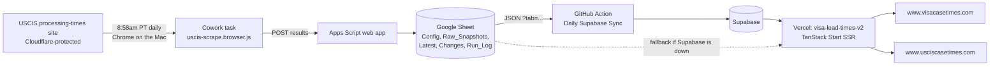

# Visa Case Times: setup and operations

Everything needed to run, update, and move **visacasetimes.com** and **usciscasetimes.com**: a USCIS processing-times tracker. Last verified 2026-10-17.

## At a glance

| Piece | Where it lives | Account |
| --- | --- | --- |
| Domains (registrar + DNS) | GoDaddy | your GoDaddy login |
| Website hosting | Vercel project **`visa-lead-times-v2`**, team "bhushan's projects" (`bhushan-projects`, Hobby plan) | Vercel |
| Code | GitHub **`bhushan305/visa-lead-times`** (public), branch `main` | GitHub `bhushan305` |
| Raw data | Google Sheet **"USCIS Processing Times Tracker"** + its bound Apps Script | Google `bhushan@marketcrunch.ai` |
| Database the site reads | Supabase (URL in `SUPABASE_URL`) | Supabase |
| Daily USCIS scrape | Claude Cowork scheduled task **"USCIS daily scrape"**, running in Chrome on the Mac | Claude |
| Daily sheet-to-database sync | GitHub Actions workflow **"Daily Supabase Sync"** | GitHub |
| Ads | Google AdSense `pub-2935901629293366` (`public/ads.txt`) | Google |

## How it fits together



## Domains (GoDaddy)

| | visacasetimes.com | usciscasetimes.com |
| --- | --- | --- |
| Registrar | GoDaddy.com, LLC | GoDaddy.com, LLC |
| Registered / expires | 2026-06-10 / **2027-06-10** | 2026-06-10 / **2027-06-10** |
| Nameservers | ns23/ns24.domaincontrol.com | ns33/ns34.domaincontrol.com |
| `@` record | A `216.198.79.1` (Vercel) | A `216.198.79.1` (Vercel) |
| `www` record | CNAME to apex | CNAME to apex |
| Other DNS | none | TXT `google-site-verification=…` (Search Console) |
| Email (MX) | none | none |

- Both domains have registrar locks on (transfer/delete prohibited). That's normal.
- Check auto-renew in GoDaddy before June 2027.
- No mail is set up, so the site lists no email addresses. The Feedback widget (bottom-left of every page) is the contact channel. It emails you through the Apps Script.
- Don't change DNS unless you're moving hosts. Vercel manages the routing.

## Hosting (Vercel)

Project `visa-lead-times-v2` is connected to the GitHub repo and auto-deploys:

- **Push to `main` → production** (about 1–2 minutes). Other branches get preview URLs.
- Domains on the project:
  - `www.visacasetimes.com`: production, the primary and canonical host
  - `visacasetimes.com`: 308 redirect to `www.visacasetimes.com`
  - `www.usciscasetimes.com`: production, same pages. Every canonical tag points to www.visacasetimes.com, so Google treats it as a duplicate.
  - `usciscasetimes.com`: 308 redirect to `www.usciscasetimes.com`
- `vercel.json`: build command `npm run build`, output `.output/public`, and a cron that calls `/api/cron/sync` daily at 17:00 UTC. That endpoint skips the work if a sync already succeeded in the last 12 hours.
- **Duplicate project `visa-lead-times`** (no custom domains) is connected to the same repo. It rebuilds on every push and isn't needed. Delete it: open the project, then Settings → Advanced → Delete Project.

## Code

- Stack: TanStack Start (React 19, Vite, SSR via Nitro), Tailwind 4, Recharts, shadcn/ui, Supabase. Node 22 (`.nvmrc`).
- Key paths:
  - `src/routes/`: pages (`/`, `/forms`, `/form/$code`, `/case/$slug`, `/guides/*`, `/about`, `/methodology`, `/privacy`, `/terms`) plus the `/api/*` endpoints
  - `src/lib/site.ts`: the canonical origin `https://www.visacasetimes.com`, plus `canonicalUrl()`
  - `src/lib/data/repo.server.ts`: data access. It reads Supabase first, then falls back to the live Apps Script API.
  - `scripts/uscis-scrape.browser.js`: the daily USCIS scraper, which runs inside a browser tab
  - `scripts/sync-sheet-to-supabase.ts`: copies the sheet into Supabase
  - `scripts/generate-sitemap.ts`: builds `public/sitemap.xml` at build time (gitignored)
  - `supabase/migrations/`: schema for forms, cases, daily_snapshots, monthly_aggregates, historic_pt, run_log, page_views, click_events, feedback, search_queries
- npm scripts:

| Command | What it does |
| --- | --- |
| `npm run setup` | One-time setup on a Mac (`scripts/setup-mac.sh`) |
| `npm run dev` | Local site at http://localhost:3010 |
| `npm run build` | Production build (generates the sitemap first) |
| `npm run sync` | Sheet → Supabase, using `.env.local` |
| `npm run seed:historic` | Load fiscal-year averages from `data/historic-pt-seed.json` |
| `npm run env:pull` | Pull production env vars from Vercel into `.env.local` |

### Shipping a change

```bash
cd ~/Claude/VisaLeadTime
npm run dev                 # check locally
git add -A && git commit -m "…"
git push origin main        # Vercel deploys production
```

## Data pipeline

### 1. Scrape: Cowork task "USCIS daily scrape" (8:58am PT daily, on the Mac)

- **Why a browser on the Mac:** USCIS sits behind Cloudflare, which blocks datacenter IPs. Tested 2026-10-17:
  - curl from a cloud server: 403
  - curl from the home IP: 403
  - headless Chrome from a cloud server: Cloudflare "Attention Required" block page
  - Chrome on the Mac: passes

  GitHub Actions runners are datacenter IPs, so the scrape can't run there.
- **What the task does:** it opens https://egov.uscis.gov/processing-times in Chrome and injects `scripts/uscis-scrape.browser.js`. If the local folder isn't mounted, it downloads the script from GitHub. The script then:
  1. finds USCIS's `getProcessingTime` server action by name (the IDs change with each USCIS deploy)
  2. reads the active cases from the sheet's **Config** tab (`?tab=config`)
  3. queries each case, 3 at a time
  4. POSTs `{data: [...]}` to the Apps Script web app

  It refuses to write if fewer than 80% of cases succeed. A normal run takes 3–5 minutes for about 496 cases.
- **Requirements:** the Mac is awake with the Claude desktop app running, Chrome is open with the Claude extension signed in, and the task is bound to this Mac. If any of these is missing, that day is skipped. USCIS only shows current numbers, so a missed day can't be backfilled.
- **Keep it reliable:**
  - Wake the Mac before the run: `sudo pmset repeat wakeorpoweron MTWRFSU 08:50:00`. This works best with the Mac plugged in and the lid open. Check it with `pmset -g sched`.
  - Add Chrome and the Claude app to System Settings → General → Login Items.
  - If a run is missed, the GitHub Action emails you after about 2 days.
- **Manual run:** open https://egov.uscis.gov/processing-times in Chrome, open DevTools (⌥⌘J), paste the contents of `scripts/uscis-scrape.browser.js`, then check `window.__uscis` until `phase` is `"done"`. Or ask Claude to "run the USCIS scrape now".

### 2. Google Sheet + Apps Script

- Sheet "USCIS Processing Times Tracker", ID `1CNcuKdmNqfSXtFfpiHZi3_bnnvurgqw8573JEBgStuI`, in Drive folder "USCIS Processing Times".
- Tabs:
  - **Config**: the tracked cases (`active`, `logical_case_name`, `form_code`, `category_key`, `office_code`, hints). Set `active` to FALSE to stop tracking a case.
  - **Raw_Snapshots**: one row per case per run
  - **Latest**: replaced on each run
  - **Changes**
  - **Run_Log**
- Bound Apps Script project (Sheet → Extensions → Apps Script), deployed as a web app (Execute as me, Anyone):
  - `Code.gs`: `doPost` handles scrape ingest (`processAndWrite`), `updateConfig`, and feedback emails (MailApp)
  - `API.gs`: `doGet` returns JSON for `?tab=latest|raw|changes|run_log|config|forms` (`raw` also takes `days`)
- Web app URL (`APPS_SCRIPT_URL`, public): `https://script.google.com/macros/s/AKfycbwF37kFPBEYOCS9t33Ai5gzoL_XkYBFfMsKzCt9SameFmPf30wOQkqbbqn53njCdrAZ/exec`
- If you change the Apps Script, use **Deploy → Manage deployments → edit the existing deployment → New version**. That keeps the URL the same.

### 3. Sync: GitHub Action "Daily Supabase Sync"

- File: `.github/workflows/sync.yml`. Scheduled at 17:30 UTC, but GitHub usually starts it between 19:30 and 23:00 UTC. You can also run it from the Actions tab (Run workflow).
- Runs `npm run sync:ci`, then **fails if the latest Run_Log entry is more than 50 hours old**. GitHub then emails you, so a dead scrape no longer looks green.
- Repo secrets: `SUPABASE_URL`, `SUPABASE_SERVICE_ROLE_KEY`, `APPS_SCRIPT_URL`.
- Vercel's 17:00 UTC cron (`/api/cron/sync`) is a second path for the same sync.

### 4. Site

- Reads Supabase. Case pages show "as of <date>" from the latest snapshot.
- Fiscal-year history comes from `data/historic-pt-seed.json` (manual refresh from https://egov.uscis.gov/processing-times/historic-pt, then `npm run seed:historic`).

## Secrets and env vars

| Variable | Used by | Stored in |
| --- | --- | --- |
| `SUPABASE_URL` | site, sync | Vercel, GitHub secret, `.env.local` |
| `SUPABASE_ANON_KEY` | site | Vercel, `.env.local` |
| `SUPABASE_SERVICE_ROLE_KEY` | sync, cron endpoint | Vercel, GitHub secret, `.env.local` |
| `APPS_SCRIPT_URL` | site fallback, sync | Vercel, GitHub secret, `.env.local` (also has a code default) |
| `CRON_SECRET` | forced runs of `/api/cron/sync` | Vercel, `.env.local` |
| `SITE_URL` | **not used anymore** (Vercel still holds a stale `usciscasestatus.fyi` value; safe to delete) | Vercel |

- `.env.local` is gitignored. Never commit it.
- Supabase keys can always be re-copied from the Supabase dashboard (Project Settings → API).

## Moving to a new Mac

1. **Install:**
   - Xcode Command Line Tools (`xcode-select --install`, provides git)
   - Node 22 (`brew install node@22` or `nvm install 22`)
   - Google Chrome with the Claude extension, signed in
   - the Claude desktop app
2. **Get the code and set it up:**
   ```bash
   mkdir -p ~/Claude && git clone https://github.com/bhushan305/visa-lead-times.git ~/Claude/VisaLeadTime
   cd ~/Claude/VisaLeadTime && npm run setup
   ```
3. **`.env.local`:** the easiest way is to AirDrop it from the old Mac. Otherwise `npm run setup` pulls it from Vercel. Vercel won't export variables marked Sensitive; copy any empty ones from the Supabase dashboard.
4. **GitHub push access:** run `gh auth login`, or let git prompt for credentials on your first `git push`.
5. **Cowork:** in the Claude desktop app, add `~/Claude/VisaLeadTime` as a folder. Open the scheduled task **"USCIS daily scrape"** and turn on **Require this computer** on the new Mac, or ask Claude to re-link it to this computer. On the first run, if Claude says it can't find the browser, ask it to switch the task to this Mac's Chrome.
6. **Wake schedule + login items:** `sudo pmset repeat wakeorpoweron MTWRFSU 08:50:00`, and add Chrome and Claude to Login Items.
7. **Verify:**
   - `npm run dev` works
   - run the scheduled task once ("Run now")
   - the sheet's Run_Log has a new row
   - the next day's GitHub Action is green
8. **Old Mac:** nothing else is tied to it once the task is re-bound.

Nothing about the domains, Vercel, GitHub, Google, or Supabase depends on which computer you use.

## Runbooks

- **GitHub emailed "USCIS scrape is stale":**
  1. Check that the Mac is awake, Chrome is open, and the extension is connected.
  2. Run the Cowork task manually.
  3. If the scraper reports `getProcessingTime server action not found`, USCIS changed their page. Open the page with DevTools → Network, select a form, category, and office, and find the POST to `/processing-times`. Its `next-action` header and response shape show what to update in `scripts/uscis-scrape.browser.js`.
- **Site numbers look old but Run_Log is fresh:** run the GitHub Action manually (Actions → Daily Supabase Sync → Run workflow), or run `npm run sync` locally.
- **Sync fails with `ON CONFLICT DO UPDATE command cannot affect row a second time`:** two rows in Latest have different `form_label_selected` values for the same form code. The scraper builds labels as `<config form_code> | <title>` to prevent this.
- **Add a case to track:** add a row to the Config tab with `active` TRUE and USCIS's `form_code`, `category_key`, and `office_code` (the values in the USCIS dropdowns), plus a unique `logical_case_name` like `I-130 - 134A-F21 @ National Benefits Center`.
- **SEO rules:** put canonical tags in `head().links` using `canonicalUrl()`. A `{rel:"canonical"}` inside `meta` renders as `<meta rel=canonical>`, which Google ignores. Never build URLs from an env var.

## Known issues and to-dos

- [ ] `git push origin main` the local commits; this Cowork session can't push to GitHub.
- [ ] Delete the duplicate Vercel project `visa-lead-times`.
- [ ] Optionally delete the unused `SITE_URL` env var in Vercel.
- [ ] `npx tsc --noEmit` shows about 23 old type errors, mostly typed `<Link to="/form/i-485">` links that should use `to="/form/$code" params`. Builds don't type-check, so deploys still work.
- [ ] The site says "Updated daily". That's only true while the Mac scrape runs, and the staleness alert is the safety net.

## History

- **2026-06:** built on Windows (`C:\Claude\VisaLeadTime`). The scrape ran there through Claude in Chrome; GitHub only synced.
- **2026-09-21 → 2026-10-17:** no scrapes. The Windows PC went away, but the GitHub sync kept passing, so the site went stale without anyone noticing.
- **2026-10-17:** moved to the Mac.
  - Local git repaired (the copied `.git` was empty).
  - Scraper rewritten for USCIS's new Next.js page and scheduled as a Cowork task.
  - Staleness alert added to the GitHub Action.
  - Canonical tags fixed: they were rendering as `<meta>`, and sitemap/og:url URLs pointed at the nonexistent usciscasestatus.fyi.
  - Dead hello@/privacy@ email addresses removed.
